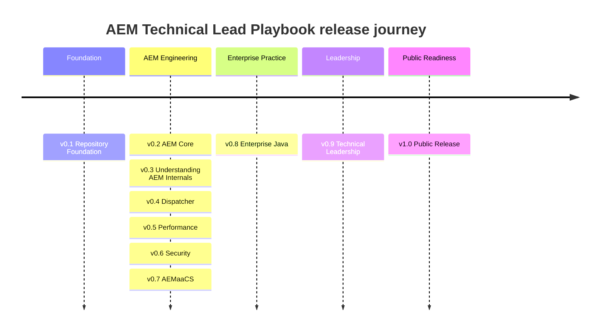
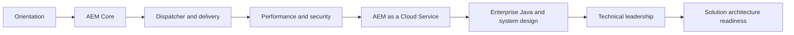
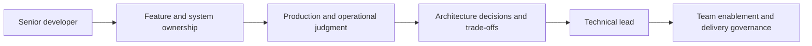
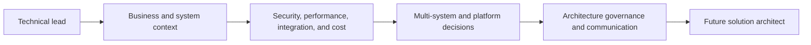

# Roadmap

## Overview

The roadmap connects repository maturity, handbook milestones, and role-based learning journeys. Delivery is milestone-driven; scope and quality determine release timing.

## Timeline

## Milestones

The version labels below describe the intended release sequence. They are not evidence that a matching Git tag or GitHub Release exists; see [Release Strategy](RELEASES.md) for the verified tag/release audit.

- **v0.1 — Repository Foundation:** Complete
- **v0.2 — AEM Core:** Published; substantive chapter is deployed to Pages, final editorial/source audit pending.
- **v0.3 — Understanding AEM Internals:** Content milestone complete; matching v0.3.0 Git tag and GitHub Release not found in the release audit.
- **v0.4 — Dispatcher:** Published; substantive chapter is deployed to Pages, final editorial/source audit pending.
- **v0.5 — Performance:** Published; substantive chapter is deployed to Pages, final editorial/source audit pending.
- **v0.6 — Security:** Published; substantive chapter is deployed to Pages, final editorial/source audit pending.
- **v0.7 — AEM as a Cloud Service:** Published; substantive chapter is deployed to Pages, final editorial/source audit pending.
- **v0.8 — Enterprise Java:** Published; substantive chapter is deployed to Pages, final editorial/source audit pending.
- **Design Patterns:** Published to Pages; final editorial/source audit pending.
- **System Design:** Published to Pages; final editorial/source audit pending.
- **v0.9 — Technical Leadership:** Published to Pages; final editorial/source audit pending.
- **Production Support:** Published to Pages; final editorial/source audit pending.
- **Interview Guide:** Published to Pages; final editorial/source audit pending.
- **Case Studies:** Published to Pages; final editorial/source audit pending.
- **Engineering Checklists:** Published to Pages; final editorial/source audit pending.
- **Reference Library:** Published to Pages; final editorial/source audit pending.
- **v1.0 — Public Release:** Planned

Release semantics and acceptance flow are defined in [RELEASES.md](RELEASES.md).

## Learning Progression

## Technical Lead Journey

## Future Architect Journey

## Phase 1 — Foundation

- [x] Repository architecture and governance
- [x] MkDocs platform, navigation, metadata, and quality gates
- [x] Contribution templates, labels, project workflow, and release strategy
- [x] Placeholder learning, checklist, diagram, template, and ADR structures

## Phase 2 — Core Learning Paths

Status note: the substantive chapters across AEM, enterprise Java, architecture, leadership, production support, interviews, case studies, checklists, and references are deployed to GitHub Pages. The strict build and deployment succeeded on commit `9d3a805c4752f5accb719a634906066f7f6df702`; final browser smoke checks and editorial/source audit remain pending. Release tag/GitHub Release history is separately documented and remains unresolved.

- [x] Understanding AEM Internals handbook
- [ ] Editorial review model and authoritative source policy
- [x] Introduction and learning roadmap (completed in PR #34)
- [ ] AEM Core content — substantive draft merged in PR #37; final publication/editorial verification pending
- [ ] Dispatcher content — substantive chapter merged in PR #39; final publication/editorial verification pending
- [ ] Security foundation — substantive chapter merged in PR #43; final publication/editorial verification pending
- [ ] Performance content — substantive chapter merged in PR #41; final publication/editorial verification pending
- [ ] AEM as a Cloud Service — substantive chapter merged in PR #44; final publication/editorial verification pending
- [ ] Enterprise Java — substantive chapter merged in PR #46; final publication/editorial verification pending
- [ ] Design Patterns — substantive chapter merged in PR #48; final publication/editorial verification pending
- [ ] System Design — substantive chapter merged in PR #50; final publication/editorial verification pending
- [ ] Technical Leadership — substantive chapter merged in PR #51; final publication/editorial verification pending

## Phase 3 — Enterprise Practice

- [x] AEM as a Cloud Service and enterprise Java — substantive chapters merged; publication verification pending
- [x] Design patterns and system design — substantive chapters merged; publication verification pending
- [ ] Production support — substantive chapter still required

## Phase 4 — Leadership and Public Readiness

- [x] Technical-leadership chapter merged; publication verification pending
- [x] Case studies, interview guide, checklists, and reference library merged; publication verification pending
- [ ] Versioned v1.0 release and community maintainer program

## Proposal Process

Open a feature request for roadmap changes. Proposals must state audience value, dependencies, reviewers, maintenance cost, target release, and measurable completion criteria.
