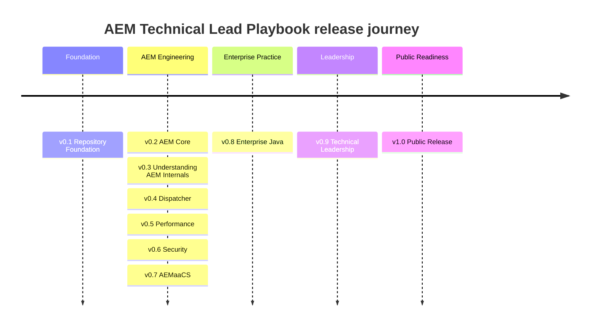
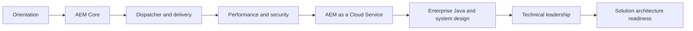
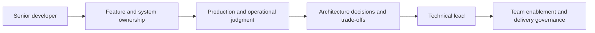
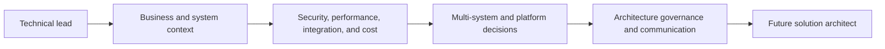

# Roadmap

## Overview

The roadmap connects repository maturity, handbook milestones, and role-based learning journeys. Delivery is milestone-driven; scope and quality determine release timing.

## Timeline

## Milestones

The version labels below describe the intended release sequence. They are not evidence that a matching Git tag or GitHub Release exists; see [Release Strategy](RELEASES.md) for the verified tag/release audit.

- **v0.1 — Repository Foundation:** Complete
- **v0.2 — AEM Core:** In review; substantive draft merged, final publication/editorial verification pending.
- **v0.3 — Understanding AEM Internals:** Content milestone complete; matching v0.3.0 Git tag and GitHub Release not found in the release audit.
- **v0.4 — Dispatcher:** In review; substantive chapter merged, final publication/editorial verification pending.
- **v0.5 — Performance:** In review; substantive chapter merged in PR #41, final publication/editorial verification pending.
- **v0.6 — Security:** In review; substantive chapter merged in PR #43, final publication/editorial verification pending.
- **v0.7 — AEM as a Cloud Service:** In review; substantive chapter merged in PR #44, final publication/editorial verification pending.
- **v0.8 — Enterprise Java:** In review; substantive chapter merged in PR #46, final publication/editorial verification pending.
- **Design Patterns:** Substantive chapter merged in PR #48; final publication/editorial verification pending.
- **System Design:** Substantive chapter merged in PR #50; final publication/editorial verification pending.
- **v0.9 — Technical Leadership:** Substantive chapter merged in PR #51; final publication/editorial verification pending.
- **Production Support:** Substantive chapter merged in PR #53; final publication/editorial verification pending.
- **Interview Guide:** Substantive chapter merged in PR #54; final publication/editorial verification pending.
- **Case Studies:** Substantive illustrative case-study chapter merged in PR #55; final publication/editorial verification pending.
- **Engineering Checklists:** Substantive checklist library merged in PR #56; final publication/editorial verification pending.
- **Reference Library:** Curated source index merged in PR #57; final publication/editorial verification pending.
- **v1.0 — Public Release:** Planned

Release semantics and acceptance flow are defined in [RELEASES.md](RELEASES.md).

## Learning Progression

## Technical Lead Journey

## Future Architect Journey

## Phase 1 — Foundation

- [x] Repository architecture and governance
- [x] MkDocs platform, navigation, metadata, and quality gates
- [x] Contribution templates, labels, project workflow, and release strategy
- [x] Placeholder learning, checklist, diagram, template, and ADR structures

## Phase 2 — Core Learning Paths

Status note: Introduction and Learning Roadmap are complete. AEM Core, Dispatcher, Performance, Security, AEM as a Cloud Service, Enterprise Java, Design Patterns, System Design, Technical Leadership, Production Support, Interview Guide, Case Studies, Engineering Checklists, and Reference Library have substantive content merged and their required CI workflows passed; final editorial and live publication verification remain pending. Release metadata is still being reconciled against repository evidence.

- [x] Understanding AEM Internals handbook
- [ ] Editorial review model and authoritative source policy
- [x] Introduction and learning roadmap (completed in PR #34)
- [ ] AEM Core content — substantive draft merged in PR #37; final publication/editorial verification pending
- [ ] Dispatcher content — substantive chapter merged in PR #39; final publication/editorial verification pending
- [ ] Security foundation — substantive chapter merged in PR #43; final publication/editorial verification pending
- [ ] Performance content — substantive chapter merged in PR #41; final publication/editorial verification pending
- [ ] AEM as a Cloud Service — substantive chapter merged in PR #44; final publication/editorial verification pending
- [ ] Enterprise Java — substantive chapter merged in PR #46; final publication/editorial verification pending
- [ ] Design Patterns — substantive chapter merged in PR #48; final publication/editorial verification pending
- [ ] System Design — substantive chapter merged in PR #50; final publication/editorial verification pending
- [ ] Technical Leadership — substantive chapter merged in PR #51; final publication/editorial verification pending

## Phase 3 — Enterprise Practice

- [x] AEM as a Cloud Service and enterprise Java — substantive chapters merged; publication verification pending
- [x] Design patterns and system design — substantive chapters merged; publication verification pending
- [ ] Production support — substantive chapter still required

## Phase 4 — Leadership and Public Readiness

- [x] Technical-leadership chapter merged; publication verification pending
- [x] Case studies, interview guide, checklists, and reference library merged; publication verification pending
- [ ] Versioned v1.0 release and community maintainer program

## Proposal Process

Open a feature request for roadmap changes. Proposals must state audience value, dependencies, reviewers, maintenance cost, target release, and measurable completion criteria.
