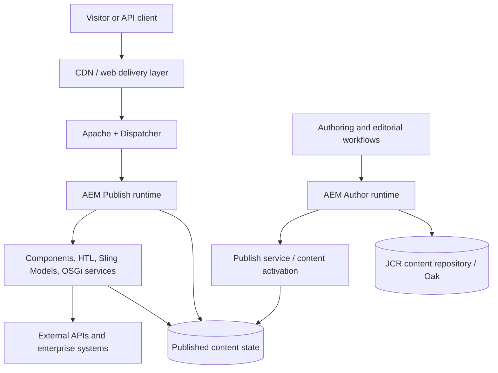

# AEM Core Architecture and Engineering Foundations

This chapter explains the core platform concepts that AEM engineers need before making component, service, repository, or delivery decisions. It focuses on **how the platform responsibilities fit together**, where state lives, and how to make changes that remain secure, observable, and supportable.

It complements [Understanding AEM Internals](../20-understanding-aem-internals/README.md), which follows the request lifecycle in greater depth. Version-sensitive details must be checked against the deployed AEM version and operating model.

## Learning outcomes

After working through this chapter, you should be able to:

- explain the responsibilities of the delivery tier, AEM runtime, Sling, OSGi services, and JCR/Oak repository;
- distinguish authored content, application code, configuration, and runtime state;
- choose appropriate component, template, service, and content-model boundaries;
- reason about permissions, repository access, queries, caching, and external integrations;
- identify which assumptions need to change when moving from AEM 6.5 to AEM as a Cloud Service;
- describe a validation plan for an AEM change before it reaches production.

## A platform mental model

AEM combines content authoring and management with a Java-based application runtime and web delivery. A useful high-level model is:

This is a conceptual view, not a deployment diagram for every AEM offering. In AEM as a Cloud Service, Adobe operates managed services and the architecture includes cloud-native publishing, content distribution, and deployment services. The precise flow differs from traditional AEM 6.5 deployments. See Adobe's [AEM as a Cloud Service architecture overview](https://experienceleague.adobe.com/en/docs/experience-manager-cloud-service/content/overview/architecture) and [AEM 6.5 platform introduction](https://experienceleague.adobe.com/en/docs/experience-manager-65/content/implementing/deploying/introduction/platform).

### Responsibilities at a glance

| Layer or capability | Primary responsibility | Engineering question |
| --- | --- | --- |
| CDN / web delivery | Edge delivery, TLS and traffic handling according to the deployment | Can this response be cached safely, and where is the cache boundary? |
| Apache and Dispatcher | Web-server integration, request filtering, and supported cache behavior | Is the request allowed, routed correctly, and cacheable? |
| AEM runtime | Executes application behavior and platform services | Which service, script, or component owns this behavior? |
| Sling | Maps requests to resources and selects scripts or servlets | What resource and renderer should handle this request? |
| OSGi services | Provides modular, configurable Java services | What is the service contract, lifecycle, and configuration boundary? |
| JCR / Oak | Stores hierarchical content and repository state | What is the content model, permission model, and access pattern? |
| External systems | Provides data or business capabilities outside AEM | What are the timeout, authentication, failure, and recovery rules? |

## Authoring, publishing, and content lifecycle

Authoring and publishing are separate responsibilities. Authors create and review content, and approved content is made available through the publishing workflow. Do not treat an author repository as the public delivery source.

A common content lifecycle is:

1. An author edits a page, asset, or structured content.
2. Templates, components, workflows, and permissions constrain how content is created and reviewed.
3. Content is previewed when the workflow requires it.
4. Authorized content is published through the mechanism supported by the deployment.
5. The delivery tier serves the published representation, potentially through Dispatcher and CDN caches.
6. Changes, invalidations, and operational signals are verified so visitors receive the intended version.

For AEM as a Cloud Service, Adobe documents Author, Preview, and Publish tiers as part of its [authoring and publishing concepts](https://experienceleague.adobe.com/en/docs/experience-manager-cloud-service/content/sites/authoring/author-publish). Do not assume that every environment or solution has identical tiers or publishing behavior.

## Content model before component implementation

Start with the content and authoring requirement, not with a Java class or dialog. Decide:

- What is the durable business concept being authored?
- Which properties belong to the content and which belong to configuration?
- How will authors reuse, localize, review, and maintain the content?
- Which component or API consumes it?
- What permissions and lifecycle rules apply?
- Can the requirement be served by standard AEM capabilities instead of a custom CRUD endpoint?

A component should represent an authorable presentation or content composition boundary, not become a container for unrelated business logic. Keep reusable behavior in services where it has a clear contract, and keep rendering code focused on preparing and presenting the required model.

Adobe's [Content Architecture guidance for AEM 6.5](https://experienceleague.adobe.com/en/docs/experience-manager-65/content/implementing/developing/bestpractices/content-architecture) recommends designing the content structure deliberately and using resource-oriented patterns. Treat these as design principles, then verify their applicability to your project and AEM version.

## Component, template, and service boundaries

### Components and templates

- **Component:** a reusable rendering and authoring unit with a clear purpose, dialog contract, and expected content structure.
- **Template:** a controlled page structure and policy boundary that helps authors compose pages consistently.
- **Sling Model:** adapts a resource or request into a presentation-oriented model; it should not silently become a broad integration or persistence layer.
- **HTL:** renders output with clear separation between markup and Java preparation logic.
- **OSGi service:** encapsulates reusable behavior, integration logic, or a capability that requires a stable Java contract and lifecycle.

Prefer the smallest design that meets the requirement. A custom servlet is not the default answer to every read/write use case. Before adding one, evaluate resource types, existing Sling endpoints, access-control implications, and whether the operation belongs in an application service.

### OSGi service design

A good service boundary should make its responsibilities and failure behavior explicit:

- define a narrow interface or clear public contract;
- use OSGi configuration for environment-specific settings instead of hardcoding endpoints or secrets;
- validate input at the boundary;
- handle external calls with explicit timeouts and appropriate error mapping;
- log useful diagnostic context without exposing secrets or personal data;
- avoid retaining request-specific objects in long-lived service fields;
- design for concurrent calls and service lifecycle changes;
- provide unit tests for success, failure, and boundary conditions.

Do not confuse an OSGi service being active with the entire feature being healthy. A service can be available while an external dependency is failing or returning invalid data.

## JCR / Oak and repository access

JCR exposes a hierarchical content model; Oak provides AEM's repository implementation. Repository structure, permissions, indexing, and access patterns are architecture decisions because they affect performance, security, and maintainability.

Use these rules of thumb:

1. Prefer the Sling Resource API for normal application-level resource access when it provides the required abstraction.
2. Use the narrowest appropriate service-user permissions; never rely on administrative repository access for application code.
3. Keep repository traversal scoped to the required subtree.
4. Avoid expensive repository queries in hot rendering paths when the same information can be modelled, navigated, or cached more appropriately.
5. When queries are necessary, inspect query plans and index coverage rather than assuming an index is used.
6. Keep JCR observation listeners narrowly scoped and their callbacks short.
7. Define what happens when content is missing, moved, unpublished, or has unexpected property values.

See Adobe's [JCR integration best practices](https://experienceleague.adobe.com/en/docs/experience-manager-65/content/implementing/developing/bestpractices/jcr-integration) for additional guidance. Validate recommendations against the specific AEM version and current product documentation.

## Security and permissions are part of the design

Security cannot be added only at the end of implementation. For each component, service, servlet, and integration, ask:

- Who is allowed to invoke it?
- Which repository paths can it read or change?
- Does it trust request parameters, selectors, suffixes, headers, or external data?
- Could it expose unpublished content or internal repository details?
- Are outbound destinations controlled to reduce server-side request forgery risk?
- Are credentials stored and rotated using the supported secret/configuration mechanism?
- Do logs and error messages reveal sensitive information?

Use least privilege, validate inputs at trust boundaries, avoid exposing internal exceptions to clients, and test denied as well as permitted access. Follow the applicable Adobe security guidance and the organization's security review process.

## Performance and operational design

Performance is a property of the whole request path, not just a single Java method. Review:

- cacheability and invalidation at CDN and Dispatcher layers;
- repository reads and query cost;
- repeated work in Sling Models, components, and services;
- synchronous external calls and their timeout budgets;
- concurrency, thread usage, and resource cleanup;
- payload size, rendering cost, and downstream dependencies;
- metrics, logs, and traceability needed to identify bottlenecks.

Measure before optimizing. A useful investigation starts with a symptom and a reproducible measurement, identifies the layer responsible, changes one variable at a time, and validates both the improvement and any regression risk. See [Performance Thinking](../00-engineering-principles/09-performance-thinking.md).

## AEM 6.5 and AEM as a Cloud Service: do not assume equivalence

Many programming concepts are shared, but deployment and operational assumptions differ.

| Concern | AEM 6.5 deployments | AEM as a Cloud Service |
| --- | --- | --- |
| Runtime and infrastructure | Depends on the chosen on-premises or managed-service topology | Adobe-managed, dynamically operated service architecture |
| Code deployment | Follows the deployment and maintenance model of the environment | Cloud Manager is the standard deployment path for customer code to cloud environments |
| Mutable content vs application code | Must follow the specific installation and project model | Package and repository content must respect the cloud service's code/content separation |
| Instance assumptions | Must account for the actual topology and failover design | Code must be cluster-aware and resilient to instance replacement and rolling updates |
| Troubleshooting | Use available logs, monitoring, repository tools, and environment access | Use Cloud Manager and the supported cloud observability and debugging capabilities |

This table is a high-level comparison, not a migration checklist. For current details, consult Adobe's [AEM as a Cloud Service development guidelines](https://experienceleague.adobe.com/en/docs/experience-manager-cloud-service/content/implementing/developing/development-guidelines), [project structure guidance](https://experienceleague.adobe.com/en/docs/experience-manager-cloud-service/content/implementing/developing/aem-project-content-package-structure), and [deployment overview](https://experienceleague.adobe.com/en/docs/experience-manager-cloud-service/content/implementing/deploying/overview).

## Worked scenario: a page component needs external product data

Suppose a page component needs product availability from an external commerce API.

1. **Clarify the contract.** Identify required fields, freshness expectations, availability, and the behavior when the API is slow or unavailable.
2. **Choose the boundary.** Keep external API access in a dedicated service; let the Sling Model prepare presentation data.
3. **Protect the boundary.** Use controlled configuration and credentials, validate inputs, set a finite timeout, and map upstream errors to safe application behavior.
4. **Plan for failure.** Decide whether to show a neutral fallback, omit the optional module, or use a bounded cache. Do not retry indefinitely or block rendering without a defined budget.
5. **Check security.** Restrict outbound destinations and avoid logging credentials or full sensitive payloads.
6. **Measure.** Track latency, failure rate, timeout count, cache behavior, and the impact on the page's response time.
7. **Validate.** Test success, empty responses, malformed payloads, timeout, authorization failure, and service outage. Confirm that the page remains usable.

The key architecture decision is not simply “use a servlet” or “use a Sling Model.” It is to establish clear responsibilities, safe failure behavior, and measurable operational expectations.

## Review checklist

Before considering an AEM core change ready for review, verify:

- [ ] The content model and authoring experience are clear.
- [ ] Components, templates, models, and services have focused responsibilities.
- [ ] Repository access is scoped and uses least privilege.
- [ ] Query and cache behavior has been considered and measured where necessary.
- [ ] External dependencies have explicit timeouts, failure handling, and observability.
- [ ] AEM 6.5 versus AEM as a Cloud Service assumptions are stated where relevant.
- [ ] Positive, negative, and failure-path tests are included.
- [ ] Relevant Adobe documentation and project-specific constraints have been reviewed.

## Recommended learning sequence

1. [Engineering Principles](../00-engineering-principles/README.md)
2. [Understanding AEM Internals](../20-understanding-aem-internals/README.md)
3. [Dispatcher](../03-dispatcher/README.md)
4. [Performance](../04-performance/README.md)
5. [Security](../05-security/README.md)
6. [AEM as a Cloud Service](../06-aemaacs/README.md)

## Authoritative references

- [Introduction to the AEM 6.5 platform](https://experienceleague.adobe.com/en/docs/experience-manager-65/content/implementing/deploying/introduction/platform)
- [AEM as a Cloud Service architecture](https://experienceleague.adobe.com/en/docs/experience-manager-cloud-service/content/overview/architecture)
- [AEM 6.5 content architecture](https://experienceleague.adobe.com/en/docs/experience-manager-65/content/implementing/developing/bestpractices/content-architecture)
- [AEM 6.5 JCR integration best practices](https://experienceleague.adobe.com/en/docs/experience-manager-65/content/implementing/developing/bestpractices/jcr-integration)
- [AEM as a Cloud Service development guidelines](https://experienceleague.adobe.com/en/docs/experience-manager-cloud-service/content/implementing/developing/development-guidelines)
- [AEM as a Cloud Service project structure](https://experienceleague.adobe.com/en/docs/experience-manager-cloud-service/content/implementing/developing/aem-project-content-package-structure)
- [Deploying to AEM as a Cloud Service](https://experienceleague.adobe.com/en/docs/experience-manager-cloud-service/content/implementing/deploying/overview)
