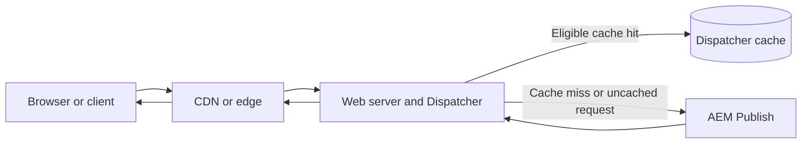

# Dispatcher: Secure Delivery, Caching, and Operations

## Purpose and audience

Dispatcher is a critical part of AEM's delivery architecture. It is commonly deployed with a web server and acts as a request filter, load balancer where configured, and cache for eligible responses. Its configuration affects security boundaries, origin load, latency, content freshness, and incident recovery.

This chapter is for AEM developers, technical leads, and engineers who design or operate publish delivery. It focuses on decision-making and diagnosis rather than treating a configuration snippet as universally safe.

## Learning outcomes

After working through this chapter, you should be able to:

- trace a request through the CDN, web tier/Dispatcher, and AEM Publish;
- explain how filters, cache rules, and invalidation work together;
- identify common cache misses, stale-content symptoms, and access-control mistakes;
- distinguish traditional Dispatcher deployments from AEM as a Cloud Service delivery;
- validate changes with configuration tools and evidence-based tests.

## 1. Where Dispatcher fits

A simplified traditional delivery path is:

The exact topology varies by environment. In AEM as a Cloud Service, Adobe operates the CDN and delivery infrastructure, while projects configure supported Dispatcher behavior through the Cloud Manager source-controlled configuration model. Do not assume a self-managed Apache/Dispatcher topology maps one-to-one to Cloud Service.

A request may be served from cache only if it passes the relevant routing and filter controls and matches an eligible cached resource. A cache miss is not itself an error: authenticated, dynamic, query-dependent, or otherwise non-cacheable requests may be expected to reach Publish.

## 2. Understand the controls separately

Dispatcher behavior is easier to reason about when configuration is divided into distinct responsibilities.

- **Virtual host and web-server routing** select the intended site and backend.
- **Filters** determine which incoming request patterns are allowed to reach AEM. Use a deny-by-default approach and add narrow, justified allow rules.
- **Cache rules** decide which paths and response patterns may be stored.
- **Invalidation and stat-file behavior** determine when cached files are considered stale or are invalidated after content changes.
- **Load balancing and health behavior**, where supported in the deployment, affect backend selection and resilience.
- **CDN policy** adds another cache and security boundary. A correct Dispatcher rule cannot compensate for an unsafe edge rule, and vice versa.

These controls are related but not interchangeable. Allowing a request through a filter does not mean it should be cached. Making a path cacheable does not make it safe to expose.

## 3. Security-first filter design

Dispatcher filters are a key part of the delivery security boundary. They should be reviewed as an allowlist of intended public request shapes, not as a list of exceptions accumulated until a page works.

Recommended review approach:

1. Start from the supported baseline for the target AEM version and deployment model.
2. Deny requests by default.
3. Allow only required methods, paths, selectors, extensions, and request patterns.
4. Explicitly review sensitive areas such as repository and system paths, query builders, debugging endpoints, administrative consoles, and unexpected servlet paths.
5. Keep author-only and administrative functionality out of public Publish delivery unless a documented architecture explicitly requires a protected route.
6. Test both allowed and forbidden requests. A successful homepage request is not proof that the filter set is secure.
7. Treat filter changes as security-sensitive code: review the diff, run the supported validator, and record test evidence.

Avoid copying a filter file from another project without understanding its AEM version, application routes, custom servlets, and deployment model. A broad allow rule may silently expose endpoints that were never intended for public use.

### Example review questions

- Is each allowed path required by a user-facing feature?
- Can a wildcard unintentionally allow selectors, extensions, or methods beyond the intended route?
- Are internal APIs and operational endpoints blocked at the edge and at origin?
- Does the rule behave as expected for encoded paths, unusual suffixes, and trailing slashes?
- Can a negative test prove that a disallowed path is rejected before it reaches Publish?

Use the syntax and supported directives documented for your deployment. The examples above are review principles, not a substitute for the version-specific configuration reference.

## 4. Caching: what belongs at the edge?

Caching reduces repeated origin work and can improve latency, but only when the response is safe to reuse.

Good candidates often include public, stable assets and rendered pages whose output does not vary per user. Common candidates for bypass or careful policy include authenticated responses, personalized content, form submissions, session-dependent responses, and endpoints whose output changes based on query parameters.

For each proposed cache rule, answer:

- **Identity:** What makes two requests equivalent—path, query string, headers, cookies, or another dimension?
- **Freshness:** How long can the response remain valid at each cache layer?
- **Invalidation:** What event causes the response to be refreshed?
- **Privacy:** Could one user's response be served to another user?
- **Failure mode:** What happens if the cache is cold, stale, or unavailable?

Do not enable caching simply because a URL ends in `.html`. The response's semantics and personalization behavior matter more than its extension.

### Multiple cache layers

A production site may have a browser cache, CDN cache, and Dispatcher cache. Each layer can have different TTLs and invalidation behavior. When content appears stale, identify which layer served the response before purging everything.

Useful evidence includes response headers, CDN diagnostics, Dispatcher logs, timestamps, the requested URL, and the relevant invalidation events. Header names and observability differ by environment; confirm them rather than assuming a particular header is always present.

## 5. Invalidation and content freshness

A content activation or deployment does not automatically prove every cache layer has the latest representation. Dispatcher invalidation behavior depends on the configured rules and deployment model; CDN caching may add a separate freshness window.

When diagnosing stale content:

1. Capture the exact URL, time, environment, and observed content version.
2. Confirm the change is present on the intended Publish tier.
3. Determine whether the response came from CDN, Dispatcher, or Publish.
4. Inspect invalidation behavior and cache timestamps or logs where available.
5. Check whether the URL's cache policy or query variation causes a different cached object.
6. Perform the narrowest supported purge or invalidation.
7. Re-request the URL and confirm both content correctness and expected cache behavior.

Avoid making a global cache flush the first diagnostic step. It may hide the root cause and create an origin traffic spike. For content that must update predictably, document the freshness contract across all cache layers.

## 6. Traditional Dispatcher and AEM as a Cloud Service

The delivery model is version- and environment-sensitive. Treat the following as a decision guide, then verify current Adobe documentation for the project.

### Traditional or self-managed deployments

- The team may operate Apache and Dispatcher configuration as part of its web tier.
- Cache directories, invalidation behavior, web-server directives, log access, and load-balancing settings depend on the installed version and topology.
- Operational access may permit direct inspection of the web server and cache filesystem, subject to the organization's controls.

### AEM as a Cloud Service

- Dispatcher configuration is maintained in the project source and deployed through the supported Cloud Manager process.
- Use Adobe's Dispatcher SDK/tools and the validator that matches the current Cloud Service configuration model.
- Supported directives and configuration structure can differ from older on-premises or AMS configurations.
- Do not assume arbitrary Apache directives, filesystem access, or operational procedures from a self-managed server are available.
- Review whether the project uses the flexible or legacy Dispatcher configuration mode and follow the relevant current migration and validation guidance.

Do not use a local SDK validation result as proof that every production behavior is correct. It is an important gate, but it does not replace request-level tests in a representative environment.

## 7. Troubleshooting matrix

### Request returns 403

- Confirm the request path, method, selectors, extension, and host.
- Inspect Dispatcher filter decisions and relevant web-server logs.
- Verify the request is intended to be public and that the allow rule is narrow but sufficient.
- Test a known allowed path and a known forbidden path to detect overly broad or overly restrictive rules.
- Do not resolve the incident by adding a global allow rule.

### Request returns 404

- Determine whether the URL maps to an existing published resource.
- Confirm the correct virtual host and Publish backend are selected.
- Check whether filters, rewrites, selectors, or extension handling changed the request.
- Compare direct origin behavior with the public delivery path where access and policy permit.
- Check for stale cached negative responses if the deployment's cache policy permits them.

### Content is stale after activation

- Establish which cache layer served the response.
- Confirm Publish has the new content.
- Review invalidation rules, TTLs, and CDN policy.
- Test the exact URL, including host and query string.
- Use a scoped purge only after identifying the likely stale layer.

### Publish traffic or latency suddenly increases

- Compare cache-hit behavior and request volume before and after the change.
- Check whether cache rules were removed or a formerly cacheable response became dynamic.
- Inspect high-cardinality query strings and URL variations.
- Review CDN and Dispatcher policy changes alongside Publish health and response-time metrics.
- Roll back or narrow the change if evidence links it to the regression.

### AEM as a Cloud Service configuration validation fails

- Read the validator output rather than guessing at directives.
- Confirm the project configuration mode and expected directory structure.
- Compare the configuration against the current Adobe documentation for that mode.
- Remove unsupported directives or migrate them using Adobe's supported guidance.
- Re-run validation and review the full diff before opening or merging the deployment change.

## 8. Change-review checklist

Before merging a Dispatcher change, confirm:

- [ ] The target environment and deployment model are explicit.
- [ ] Filters follow deny-by-default and allow only required public routes.
- [ ] Negative tests cover sensitive and unintended paths.
- [ ] Cache rules account for personalization, cookies, query strings, and response semantics.
- [ ] Invalidation and TTL behavior are understood across CDN and Dispatcher.
- [ ] The configuration validator for the target model passes.
- [ ] Relevant request-level smoke tests pass in a representative environment.
- [ ] Logs and diagnostics are sufficient to investigate 403, 404, stale content, and cache-miss regressions.
- [ ] Rollback steps and expected impact are documented.
- [ ] Adobe documentation for the exact deployment model and version has been checked.

## 9. Practice scenario

A team deploys a new public product-detail page. The page works in Publish but returns 403 through the public domain. A developer proposes allowing all requests under the application's content root.

A stronger investigation is:

1. Capture the exact public URL and request method.
2. Verify the page is published and the expected host maps to the correct site.
3. Inspect the filter decision and identify the specific unmatched request pattern.
4. Confirm the required path and selectors are part of the intended public contract.
5. Add the narrowest justified allow rule and a negative test for neighboring sensitive paths.
6. Run the supported configuration validator and test through the public delivery path.
7. Review caching separately; the fix to request eligibility does not imply the page should be cached.

This approach solves the specific failure without expanding the public attack surface unnecessarily.

## Authoritative references

Use documentation matching the AEM version and delivery model. These Adobe references are starting points; verify the current content and applicable configuration mode during implementation.

- [Dispatcher overview and concepts](https://experienceleague.adobe.com/en/docs/experience-manager-dispatcher/using/dispatcher)
- [Dispatcher configuration](https://experienceleague.adobe.com/en/docs/experience-manager-dispatcher/using/configuring/dispatcher-configuration)
- [Dispatcher in AEM as a Cloud Service](https://experienceleague.adobe.com/en/docs/experience-manager-cloud-service/content/implementing/content-delivery/disp-overview)
- [Content delivery in AEM as a Cloud Service](https://experienceleague.adobe.com/en/docs/experience-manager-cloud-service/content/implementing/content-delivery/overview)
- [Migration from AMS to AEM as a Cloud Service](https://experienceleague.adobe.com/en/docs/experience-manager-cloud-service/content/implementing/content-delivery/ams-aem)
- [Dispatcher transformation and migration tools](https://experienceleague.adobe.com/en/docs/experience-manager-cloud-service/content/migration-journey/refactoring-tools/dispatcher-transformation-utility-tools)

## Completion criteria

This chapter is ready to be marked published only after its technical/editorial review is complete, internal links and references are checked, the strict documentation build and all required CI checks pass, and the published page is verified. The presence of this content in the repository alone is not release evidence.
