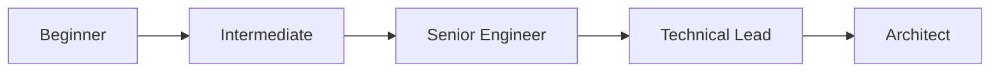
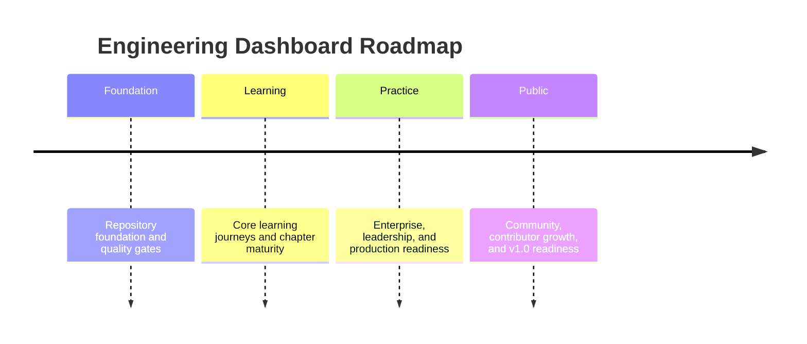

# Engineering Dashboard

!!! tip "Project status"
    This dashboard is the central status surface for the AEM Technical Lead Playbook. It highlights project maturity, learning progress, release movement, and platform readiness without repeating the full handbook content.

## Repository Health

!!! warning "Release evidence pending"
    The 2026-10-24 audit found only `v0.1.1` and `v0.2.0` Git tags, both pointing to the same commit (`c78d41c1ddf7038034a5e99b35f0aac72a508217`), and no GitHub Releases. The changelog's `v0.3.0` and former dashboard's `v0.4.0` claims are not backed by matching release records. Do not use a percentage estimate as a completion claim; chapter status is tracked in the inventory and requires editorial and live-site evidence.

The documentation platform is deployed and its latest recorded CI/Pages run passed. The remaining work is acceptance-oriented: chapter-by-chapter technical and source review, a browser smoke check, and reconciliation of the formal release tag/release record.

| Area                        | Status      | Signal                                                                                                                                      |
| --------------------------- | ----------- | ------------------------------------------------------------------------------------------------------------------------------------------- |
| Documentation Coverage      | Strong      | Handbook structure, learning topology, and navigation are in place.                                                                         |
| Repository Quality          | Strong      | Formatting, linting, spell checking, link validation, and strict MkDocs validation are part of the quality bar; latest recorded run passed. |
| Architecture Documentation  | Strong      | ADRs, folder structure guidance, and documentation architecture patterns are documented and maintained.                                     |
| Learning Content            | In Progress | Substantive content is merged across the primary learning paths; final editorial/source audit remains.                                      |
| Interview Readiness         | In Progress | Interview material is available for practical senior-level preparation; review remains open.                                                |
| Technical Leadership        | In Progress | Leadership and production stewardship chapters are deployed; editorial review remains open.                                                 |
| Production Engineering      | In Progress | Operational reasoning and support-readiness material is available; editorial review remains open.                                           |
| Open Source Readiness       | Strong      | Governance, contribution guidance, release strategy, and repository ownership signals are established.                                      |
| Community Growth            | In Progress | The project is positioned for broader maintainership, contributor onboarding, and public adoption.                                          |

## Deployment and Release Evidence

- **Latest recorded main commit:** `d0f2b8379bf0aaea7a2e262cb23f4dee9933c61f`.
- **Latest recorded GitHub Actions run:** [Run 40048778350](https://github.com/srma4tech/aem-technical-lead-playbook/actions/runs/40048778350).
- **Recorded checks:** Build Documentation, Deploy GitHub Pages, lint, spell, and links all succeeded.
- **Published site:** [AEM Technical Lead Playbook](https://srma4tech.github.io/aem-technical-lead-playbook/).
- **Live browser smoke check:** still pending. CI success and a generated Pages artifact confirm build/deployment, but do not substitute for checking the rendered site in a browser.
- **SEO metadata:** relevant project keywords are configured in `mkdocs.yml`; generated site output was previously inspected to confirm the keywords meta tag is present.
- **Git tags:** `v0.1.1` and `v0.2.0`, both pointing to the same commit.
- **GitHub Releases:** none found in the last audit.
- **Canonical current release:** not declared until the release boundary, tag, and release record are reconciled.

The deployment status above is evidence from the recorded Actions run; rerun the required checks against the final release candidate before a formal release.

## Learning Progress

### Completed chapters

- [Introduction](00-introduction/README.md)
- [Engineering Principles](00-engineering-principles/README.md)
- [Learning Roadmap](01-learning-roadmap/README.md)
- [Understanding AEM Internals](20-understanding-aem-internals/README.md)
- [Repository Foundations and Governance](https://github.com/srma4tech/aem-technical-lead-playbook/blob/main/README.md)

### Chapters deployed to Pages; final editorial/source audit pending

- [AEM Core](02-aem-core/README.md)
- [Dispatcher](03-dispatcher/README.md)
- [Performance](04-performance/README.md)
- [Security](05-security/README.md)
- [AEM as a Cloud Service](06-aemaacs/README.md)
- [Enterprise Java](07-enterprise-java/README.md)
- [Design Patterns](08-design-patterns/README.md)
- [System Design](09-system-design/README.md)
- [Technical Leadership](10-technical-lead/README.md)
- [Production Support](11-production-support/README.md)
- [Engineering Checklists](12-checklists/README.md)
- [Interview Guide](13-interview-guide/README.md)
- [Case Studies](14-case-studies/README.md)
- [Reference](15-reference/README.md)

### Remaining v1.0 readiness work

- Complete technical/editorial and source audit across substantive chapters.
- Perform a live browser smoke check of navigation, key links, responsive layout, and representative chapter pages.
- Resolve remaining accessibility, source-quality, or content-quality gaps found during review.
- Confirm the release boundary, create the canonical Git tag and GitHub Release, and verify the release-candidate deployment.
- Rerun the strict site build and required CI checks against the final release candidate.

Progress percentages are intentionally omitted until the chapter inventory supports a defensible acceptance-based calculation.

## Repository Statistics

Repository counts are intentionally omitted until they can be regenerated from the current repository tree; use the chapter inventory and repository search for current coverage.

!!! note "Maintenance note"
    Repository statistics should be regenerated from the repository tree when needed; do not carry forward stale counts.

## Learning Paths

### Progress by role

- Beginner — active foundation; acceptance status tracked in the chapter inventory.
- Intermediate — in progress; acceptance status tracked in the chapter inventory.
- Senior Engineer — emerging; acceptance status tracked in the chapter inventory.
- Technical Lead — in progress; acceptance status tracked in the chapter inventory.
- Architect — future readiness; acceptance status tracked in the chapter inventory.

## Roadmap

### Status summary

- **Completed:** repository foundation, navigation, governance, release strategy, and core handbook setup.
- **In progress:** learning-path maturity, technical/editorial audit, and platform polish.
- **Planned:** final public-readiness review, formal release evidence, and community growth.
- **Future vision:** a globally discoverable, contributor-led engineering platform for AEM and technical leadership education.

## Engineering Mentor AI

!!! warning "Coming Soon"
    This section is reserved for future AI-driven coaching and engineering guidance.

Planned capabilities:

- Interactive Learning
- Interview Practice
- Architecture Discussions
- Production Debugging

The goal is to support asynchronous coaching and guided learning while preserving the high editorial and architectural quality of the handbook.

## Open Source

| Area              | Direction                                                                                                                                |
| ----------------- | ---------------------------------------------------------------------------------------------------------------------------------------- |
| How to Contribute | Use [CONTRIBUTING.md](https://github.com/srma4tech/aem-technical-lead-playbook/blob/main/CONTRIBUTING.md) and the contributor templates. |
| Open Issues       | Monitor the repository for roadmap alignment and documentation improvements.                                                             |
| Future Milestones | Advance chapter maturity, strengthen editorial review, and scale contributor readiness.                                                  |
| Community Goals   | Build a trusted, high-signal technical learning platform for AEM and engineering leadership.                                             |

## Related Pages

- [Home](index.md)
- [Release Dashboard](release-dashboard.md)
- [Chapter Inventory](chapter-inventory.md)
- [Roadmap](ROADMAP.md)
- [Learning Roadmap](01-learning-roadmap/README.md)
- [Under Active Development](under-active-development.md)
- [Introduction](00-introduction/README.md)
