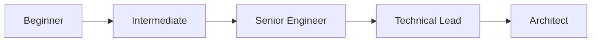
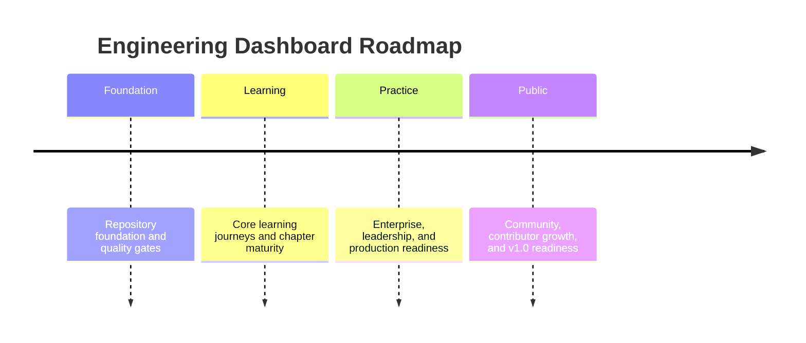

# Engineering Dashboard

!!! tip "Project status"
This dashboard is the central status surface for the AEM Technical Lead Playbook. It highlights the project’s maturity, learning progress, release movement, and platform readiness without repeating the full handbook content.

## Repository Health

!!! warning "Release evidence pending"
The last documented changelog version is `v0.3.0`, while this dashboard previously recorded `v0.4.0`. Canonical Git tag and GitHub Release evidence still needs verification. Do not use a percentage estimate as a completion claim; chapter status is tracked in the inventory and requires editorial and live-site evidence.

The repository is evolving from a strong documentation foundation into an engineering education platform with clearer delivery signals, role-based progression, and production-readiness language.

| Area                       | Status      | Signal                                                                                                              |
| -------------------------- | ----------- | ------------------------------------------------------------------------------------------------------------------- |
| Documentation Coverage     | Strong      | Core handbook structure, learning topology, and navigation are now in place.                                        |
| Repository Quality         | Strong      | Formatting, linting, spell checking, link validation, and strict MkDocs validation are all part of the quality bar. |
| Architecture Documentation | Strong      | ADRs, folder structure guidance, and documentation architecture patterns are documented and maintained.             |
| Learning Content           | In Progress | Foundational and role-based chapters are being expanded into a richer learning experience.                          |
| Interview Readiness        | In Progress | Interview-related material is being structured for practical senior-level preparation.                              |
| Technical Leadership       | In Progress | Leadership and production stewardship patterns are being formalized.                                                |
| Production Engineering     | In Progress | Operational reasoning and support readiness are becoming core curriculum themes.                                    |
| Open Source Readiness      | Strong      | Governance, contribution guidance, release strategy, and repository ownership signals are established.              |
| Community Growth           | In Progress | The project is positioned for broader maintainership, contributor onboarding, and public adoption.                  |

## Release Evidence

- Last documented changelog version: `v0.3.0`.
- Canonical Git tag and GitHub Release: verification pending.
- No newer release version is declared in this dashboard until tag/release evidence is confirmed.
- Current chapter-level state: substantive content is merged across the primary learning paths; final editorial review, strict site build, and live-page verification remain required.

## Learning Progress

### Completed chapters

- [Introduction](00-introduction/README.md)
- [Engineering Principles](00-engineering-principles/README.md)
- [Learning Roadmap](01-learning-roadmap/README.md)
- [Understanding AEM Internals](20-understanding-aem-internals/README.md)
- [Repository Foundations and Governance](https://github.com/srma4tech/aem-technical-lead-playbook/blob/main/README.md)

### Chapters with substantive content merged; publication review pending

- [AEM Core](02-aem-core/README.md)
- [Dispatcher](03-dispatcher/README.md)
- [Performance](04-performance/README.md)
- [Security](05-security/README.md)
- [AEM as a Cloud Service](06-aemaacs/README.md)
- [Enterprise Java](07-enterprise-java/README.md)
- [Design Patterns](08-design-patterns/README.md)
- [System Design](09-system-design/README.md)
- [Technical Leadership](10-technical-lead/README.md)
- [Production Support](11-production-support/README.md)
- [Engineering Checklists](12-checklists/README.md)
- [Interview Guide](13-interview-guide/README.md)
- [Case Studies](14-case-studies/README.md)
- [Reference](15-reference/README.md)

### Remaining v1.0 readiness work

- Technical and editorial audit across all substantive chapters
- Verify strict MkDocs build and GitHub Pages deployment
- Inspect live pages, navigation, responsive layout, and key links
- Confirm canonical release tag and GitHub Release evidence
- Resolve any remaining accessibility, source, or content-quality gaps

Progress percentages are intentionally omitted until the chapter inventory supports a defensible acceptance-based calculation.

## Repository Statistics

These figures represent the current repository structure and documentation asset breadth.

Repository counts are intentionally omitted until they can be regenerated from the current repository tree; use the chapter inventory and repository search for current coverage.

!!! note "Maintenance note"
Repository statistics should be regenerated from the repository tree when needed; do not carry forward stale counts.

## Learning Paths

### Progress by role

- Beginner — active foundation; percentage pending inventory.
- Intermediate — in progress; percentage pending inventory.
- Senior Engineer — emerging; percentage pending inventory.
- Technical Lead — planned expansion; percentage pending inventory.
- Architect — future readiness; percentage pending inventory.

## Roadmap

### Status summary

- Completed: repository foundation, navigation, governance, release strategy, and core handbook setup.
- In Progress: learning path expansion, chapter maturity, and platform polish.
- Planned: advanced enterprise practice, public readiness, and community growth.
- Future Vision: a globally discoverable, contributor-led engineering platform for AEM and technical leadership education.

## Engineering Mentor AI

!!! warning "Coming Soon"
This section is reserved for future AI-driven coaching and engineering guidance.

Planned capabilities:

- Interactive Learning
- Interview Practice
- Architecture Discussions
- Production Debugging

The goal is to support asynchronous coaching and guided learning while preserving the high editorial and architectural quality of the handbook.

## Open Source

| Area              | Direction                                                                                                                                |
| ----------------- | ---------------------------------------------------------------------------------------------------------------------------------------- |
| How to Contribute | Use [CONTRIBUTING.md](https://github.com/srma4tech/aem-technical-lead-playbook/blob/main/CONTRIBUTING.md) and the contributor templates. |
| Open Issues       | Monitor the repository for roadmap alignment and documentation improvements.                                                             |
| Future Milestones | Advance chapter maturity, strengthen editorial review, and scale contributor readiness.                                                  |
| Community Goals   | Build a trusted, high-signal technical learning platform for AEM and engineering leadership.                                             |

## Related Pages

- [Home](index.md)
- [Release Dashboard](release-dashboard.md)
- [Roadmap](ROADMAP.md)
- [Learning Roadmap](01-learning-roadmap/README.md)
- [Under Active Development](under-active-development.md)
- [Introduction](00-introduction/README.md)
