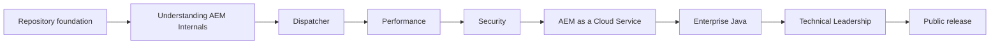

# Release Dashboard

## Current release

The release audit on 2026-10-24 found only `v0.1.1` and `v0.2.0` Git tags, both pointing to commit `c78d41c1ddf7038034a5e99b35f0aac72a508217`, and no GitHub Releases. The changelog's `v0.3.0` entry and the former Engineering Dashboard's `v0.4.0` claim are not backed by matching tag/release records.

- Last documented changelog entry: v0.3.0
- Verified Git tags: v0.1.1 and v0.2.0 (both point to the same commit)
- GitHub Releases: none found
- Status: release metadata reconciliation required; no canonical current release declared

## Completed chapters

- [x] Introduction

- [x] Engineering Principles
- [x] Learning Roadmap
- [x] Understanding AEM Internals
- [x] Repository foundation, governance, and quality gates

## In progress

### Planned next releases

- v0.4 — Dispatcher: published to Pages; final editorial/source audit pending
- v0.5 — Performance: published to Pages; final editorial/source audit pending
- v0.6 — Security: published to Pages; final editorial/source audit pending
- v0.7 — AEM as a Cloud Service: published to Pages; final editorial/source audit pending
- v0.8 — Enterprise Java: published to Pages; final editorial/source audit pending
- v0.9 — Technical Leadership: published to Pages; final editorial/source audit pending
- v1.0 — Public release: full editorial/source audit, final browser smoke checks, canonical tag/release creation, and deployment verification required

## Learning progress

The playbook is structured to help readers move from:

1. engineering judgment and platform fundamentals
2. AEM internals and delivery behavior
3. production ownership and resilience
4. system design and architectural leadership

## Repository statistics

- Documentation pages: published and curated in the `docs/` tree
- Governance and community controls: maintained in the repository root
- Quality gates: formatting, markdown linting, spell checking, and link validation
- Publication model: GitHub Pages with Material for MkDocs

## Roadmap progress

## Recommended next reading

- [Engineering Dashboard](engineering-dashboard.md)
- [Introduction](00-introduction/README.md)
- [Learning Roadmap](01-learning-roadmap/README.md)
- [AEM Engineering overview](20-understanding-aem-internals/README.md)
- [Engineering Principles](00-engineering-principles/README.md)

## Contribution signal

This project is intentionally incremental. New chapters are added when their underlying content can be reviewed, linked, and maintained with the same quality bar as the rest of the handbook.
